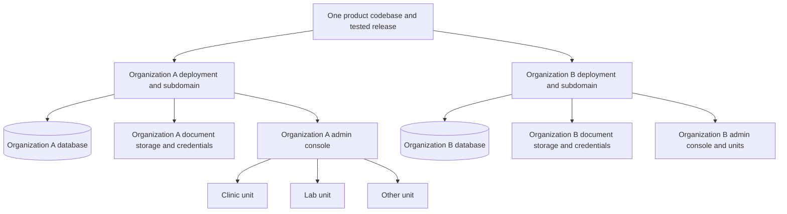

# Organization and operating-unit model

> Current demo scope: Organization A has two clinics; Organization B has one.
> Labs are future scope. Any lab workflow/scenario below is future design, not a
> demo requirement. D01-D18 in [DEMO-DECISIONS.md](DEMO-DECISIONS.md) are approved.
> See [DEMO-VERIFICATION.md](DEMO-VERIFICATION.md) for current implementation/test status.

Date: 31 October 2026. Status: accepted product direction; implementation pending.
This replaces the earlier one-instance/database-per-clinic proposal in this file.
The user's latest direction is authoritative over older handovers and review assumptions.

## Product structure and naming

The ORGANIZATION is the tenant, deployment, database, credential, session and storage boundary.
An organization contains operating UNITS: clinics, laboratories, and other supported unit types.
A unit is a business location/team/service operation, not an OS process or deployment.
Use `unit` / `operating unit` in the domain model and user-friendly labels such as
Clinics and Labs in the UI. Avoid `process` as the entity name because it also means
a workflow or running program. Workflows can belong to units without defining them.

One organization has one subdomain and its own configuration. Its admin panel (organization console)
maintains all units and has a section and metrics for each unit. Customers/patients
can be handled across units of the same organization, subject to access permissions.
Different organizations do not share customer records, credentials, sessions or storage.

## Target topology

Recommended MVP: one independently configured app deployment per organization, one database
per organization, and units inside that database. Separate physical machines are optional.
The organization admin console is part of that app, not a separate service federating
clinic databases. A small platform deployment registry may be useful later but must
not become a central patient store or grant routine access to every organization.

Pin each deployment to its expected organization ID. Select configuration from a trusted
host/subdomain mapping, never a caller-supplied database URL or unchecked Host header.
Reject a mismatched organization in login, session resume, REST and legacy paths.
Use unique organization runtime and migration credentials, host-only cookies, isolated
storage roots/buckets or enforced namespaces, and separate encryption-key references.
Revoke unintended cross-organization database access and role membership. Sharing a server
or provider account still shares infrastructure/administrator risk.

No per-unit database router, per-clinic deployment fleet, cross-clinic login exchange,
or cross-database reporting federation is needed for this model. Do not introduce
these merely to preserve the previous proposal.

## Data ownership and access

| Scope | Examples | Rules |
| --- | --- | --- |
| Product | Code, dependency lockfile, supported capabilities | Shared release artifact across organizations; no organization data |
| Organization | Customers/patients, staff identity, roles, defaults, catalogues, form definitions | One organization database; access still requires permissions |
| Unit | Appointments, encounters, lab jobs, local resources, overrides, attributed transactions | Unit ID plus required organization identity; unit-scoped grants |
| Assignment | Staff-to-unit access, form-to-unit availability | Explicit references and active/effective state |

Introduce an organization record and typed units. An organization owns users and sessions; users may
have organization-wide grants and/or explicit grants to selected units. Switching a unit
changes the working context, not the identity or login. Do not use role names as
permission checks. Platform operator, organization administrator and unit staff are separate
capabilities; a maintenance role does not automatically expose clinical/financial data.

One customer/patient identity belongs to the organization and may have encounters at multiple
units. Records must retain originating unit, author and timestamps. Organization-wide search,
viewing clinical history, editing identity and taking payments are separately authorized
operations. Scope search/autocomplete/export/document access as carefully as detail pages.
A permitted cross-unit clinical workflow must not accidentally grant cross-unit finance.
Labs need their own workflow capabilities, not all clinic fields forced onto a new name.

Keep organization RLS/context for defense in depth even with a database per organization. Apply unit
access rules to unit-owned records; do not blanket-filter every table by active unit,
which would break authorized shared patients and organization defaults. Table ownership must
be explicitly classified. Define deliberate treatment of organization-wide rows with no unit,
and test fail-closed missing/invalid context. Unit type alone never grants permissions.

Stable UUIDs identify records. An organization-wide internal patient ID prevents duplicate
customers merely because they attend another branch. The display UHID and receipt
sequence scope still need an explicit business rule and import mapping: do not assume
all existing clinic-local identifiers are globally unique or renumber financial records.
Organization grouping does not establish a shared legal billing entity; receipt identity,
numbering, tax details and credit/balance scope must reflect the actual issuer.

## Defaults and controlled overrides

Effective configuration: product defaults -> organization defaults/policies -> permitted
unit overrides. The organization remains authoritative about which fields may be overridden,
allowed values/ranges, unit-type applicability, permissions and approval requirements.
Examples include organization templates/catalogues with local timings, chairs, contacts and
approved fees. Runtime dependencies stay in the product release, not unit settings.

Define a typed settings registry: key, type/schema, default, ownership, override policy,
validation, sensitivity, effective dates and audit behavior. Distinguish inherit from
an explicit empty/null value. Support preview, reset-to-inherit and conflict validation.
An organization policy change that invalidates an override must resolve it explicitly before
publication or apply a documented enforced fallback; never silently bypass the leash.
Validate the same rules server-side for UI, imports, scripts and legacy requests.

Version organization defaults and unit overrides. Keep immutable audit history, optimistic
concurrency checks and the effective version used by a write. Updates in a single
organization database can publish atomically; invalidate/version caches and define behavior
for in-flight requests. There is no distributed acknowledgement protocol per clinic
for normal settings in this MVP. If later adding offline/distributed services, design
that consistency problem explicitly then.

Historical receipts, clinical records and submissions retain their relevant price,
identity and template/version snapshots. Changing a default must not rewrite history.
Do not store provider credentials in ordinary inherited settings payloads or expose
secrets to the browser. Organization integrations may partition document paths by unit/customer
for organization while retaining the organization storage boundary and authorized access.

## Forms managed by the organization

Organization administrators create/version/publish forms in the organization console and assign
published forms to selected units, optionally by unit type with explicit semantics.
Use a form definition/version plus an assignment relation rather than copying a form
into each unit. Assignment controls availability; permissions separately control
publish, fill and view. Define the effect of new units on any all-units assignment.

Submissions belong to the organization, customer where relevant, originating unit and exact
form version. Unassignment blocks new use but must not erase historical submissions.
Existing drafts remain pinned to a version or use an explicit upgrade process.
Local customization is permitted only through declared override/variant rules.

## Console and metrics

The console is the organization's admin panel with organization overview, unit directory/sections,
customer search, forms/assignments, shared settings/override controls, staff access and
audit. A unit view filters work and metrics without requiring another login.

Reports can query the one organization database directly through authorized APIs. Define
attribution by event: registration/acquisition unit, visit unit, performing lab/unit,
collecting unit and issuing billing entity can differ. Count unique organization customers
once in an organization total while permitting unit visits/customer activity to overlap.
Prevent duplication from joins, transfers, refunds and cross-unit work. Label currency,
reporting window, timezone and calculated-at time. Do not add unlike currencies.
Use operational-health screens separately from patient/financial permissions.

## Releases and recovery

Software release unit = ORGANIZATION. Build once from one dependency lockfile, test with
fictional organizations/units, deploy to a test organization, then one canary organization, then other organizations.
Each organization has its own deployed version, database migration history and health checks.
All units in an organization normally run the same code/schema version; rollout a feature or
form to selected units with controlled activation, not separate unit schema migrations.
Organization configuration publication, form publication/assignment and product deployment
are different actions with separate versions, permissions and audit trails.

One organization database simplifies transactions and reporting but makes database failure,
bad migration and restore affect all its units. Back up and verify organization database,
documents, configuration and separately held keys together. Whole-organization recovery is
the baseline. Restoring one unit selectively is an advanced data-repair operation
because customers, templates and financial relationships are shared; do not promise
independent unit point-in-time restores. Define recovery targets and responders.
Code rollback requires schema compatibility; prefer additive migrations/forward fixes.

## Current implementation and refactoring freedom

Current code has one pool from DATABASE_URL, clinics/clinic_id, clinic-scoped users,
sessions, patient records, settings, storage and forced RLS. There is no implemented
organization/unit hierarchy. clinics.database_url is unused. These are implementation facts,
not requirements to preserve. REST patient updates already check stale versions;
remaining legacy/master/form writes need review.

This is a test product. Refactor, replace or remove implementations when they obstruct
the agreed model; the /exec compatibility layer and legacy screens are not permanent
architecture constraints. Preserve required business behavior and data safety. Do not
blindly rename clinic_id to brand_id: some records belong to the organization, some to a unit,
and some need both references. Classify tables and workflows before conversion.

Do not delete other workstreams' uncommitted files. Do not edit applied migrations or
reset databases merely because redesign is permitted. Prepare either new forward
migrations or an explicitly scoped rebuild of disposable test databases; real clinic
spreadsheets, backups, imported data and secrets remain protected.

## Delivery order and acceptance

1. Finalize organization/unit terminology, table ownership, access matrix and settings rules.
2. Refactor schema/context/auth to organization tenancy plus unit access; migrate/reference-map
   existing fictional fixtures and preserve real-data import decisions separately.
3. Implement organization customers, unit-attributed work, controlled settings and forms assignments.
4. Add console views and correctly attributed unit/organization reports.
5. Add per-organization provisioning, releases, backups/restore and operational checks.
6. Run serialized database tests and browser acceptance before any data cutover.

Acceptance fixture: Organization A with a clinic and lab, Organization B with a clinic. Prove
cross-organization login/session/database/storage denial; within A prove one customer can
receive clinic and lab services without duplication, restricted staff cannot access
ungranted units/fields, permitted overrides work and locked values fail server-side,
form assignment/unassignment preserves history, metrics reconcile, and a release or
restore targets the whole selected organization without changing the other organization.

## Workstreams

The four existing specialist chats have been sent this correction and asked to
revise only their owned documents: BRAND-ARCHITECTURE.md, CLINIC-OPERATIONS-PLAN.md,
CLINIC-READINESS-BACKLOG.md and BRAND-CONSOLE-SPEC.md. Older clinic-oriented filenames
are historical; their revised content must follow organization-level deployment and tenancy.
No implementation, migration, shared DB test or deployment is authorized by those
bounded design briefs. This planning update itself does not implement the new model.

GitHub access is confirmed. No additional skill import is required for this correction;
the previously identified browser/security skills remain relevant to later execution.
Open decisions: hosting/recovery targets; which settings can be overridden; unit types;
patient-history permissions; legal billing/numbering and balance scope; provider access.
Organization-wide customers, organization-level DB/session/storage separation, organization subdomains and
central form assignment are decided requirements, not open options.
