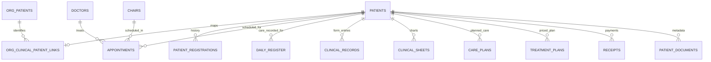

# Clinical suite: screens, APIs and linked patient data

Implementation reference, 3 November2026. This describes the familiar clinical UI
served by `api/`, including the organization bridge. It distinguishes implemented
storage from the intended future unified visit ledger. No real patient examples
or credentials are included.

## How a Save works

1. Staff signs in to an organization's deployment. The browser receives an
   HttpOnly session cookie; patient data access is checked on the server.
2. The page sends an action and fields to `/exec`. This compatibility endpoint
   replaces the old Apps Script URL while retaining the familiar screens.
   Reads can use GET; mutations and password verification use POST bodies in the
   local UI. Large records use POST. A `token` supplied in a URL is not authority.
3. The server resumes the session, checks the named permission and pins the
   transaction to the selected clinic and user. `X-KB-Clinic` and
   `X-KB-Clinic-Revision` reject stale-tab operations after a clinic switch.
4. The action validates the input and writes PostgreSQL tables inside a
   transaction. A failed legacy action rolls the transaction back. The browser
   should show success only after the server confirms the save.
5. Database audit triggers record changes on audited tables. Most clinical
   tables carry `version`, created/updated timestamps and actor IDs. This is an
   audit trail, not a completed clinical finalization/addendum workflow for every
   type of record. Not every Save endpoint enforces optimistic version checks.

The visible UHID stays the patient identifier staff know. Internal UUIDs keep
database relationships stable; they are not a replacement ID staff must learn.
Browser storage retains UI state and some legacy drafts/cache. It is not the
authoritative source for a successfully saved clinical or financial record.

## What is shared, and what belongs to a clinic

Each organization has a separate deployment/database/credentials/sessions and
storage root. Organization A's clinics share its database. Organization B uses a
different database. The bridge retains forced clinic row-level security for
legacy clinical tables, with explicit grants for permitted cross-clinic access.

`org_patients` is the central directory. `org_clinical_patient_links` maps a
central patient to existing clinic-local `patients` rows. These local rows remain
as compatibility references for foreign keys. Opening a central patient in a
clinic can create that internal reference automatically; staff do not register
the same person again. Core name/phone/DOB/gender directory fields are shared;
the whole legacy demographic/medical payload has not been physically consolidated
into one organization-level table.

The diagram shows intended/available patient references; some legacy records have
nullable `patient_id` and are resolved by UHID. Clinical/financial records retain
`clinic_id`. Composite foreign keys include the clinic where defined. Shared phone
numbers do not automatically merge patients. Conflicting imported identities need
review. Existing aliases are retained; linking does not copy a patient's history
into every clinic.

## Screen-by-screen map

Below, an action means `/exec` with `{action: "name", ...fields}`. Shared helpers
also load clinic profile, staff context, doctors and master lists as needed.

| Screen / use | Read actions | Save / change actions | Stored data and links |
|---|---|---|---|
| Sign-in and clinic selector | `authStatus`, `whoAmI`, `getWorkingClinics` | `staffLogin`, `staffLogout`, `switchWorkingClinic` | Staff/roles, sessions, `org_clinical_units`, `org_clinical_access`, session working-clinic context. A switch changes context, not ownership of records. |
| Dashboard | `whoAmI`, `getClinicOverview`, `getTodaysBirthdays`, `getFollowUps` | None; navigation only | Derived counts. Patients = central organization directory in linked deployments. Pending registrations, plans and today's appointments = current clinic. Clinical counts are withheld without clinical permission. |
| Patient Search | `getRecentPatients`, `searchOrganizationPatients`; unlinked fallback `searchPatients` | `openOrganizationPatient` on selection | Central `org_patients`, link table and current clinic reference. Default recent list is current-clinic references, max20; search is organization-wide. Appointment ordering uses latest non-cancelled/non-no-show appointment up to now, then registration as fallback. |
| Patient folder / History | `getPatient`, `getPatientHistory`, `getPatientOutstanding` when permitted | Opening may establish the internal clinic reference | History reads permitted clinics and existing register/registration/form/chart/case records. It returns paginated summaries and clinic/recorded doctor/material fields, not whole financial payloads. |
| Registration / demographics | `getPending`, `getPatient`, `getNextUHID`, `checkDuplicate`, `patientLookup`, master lists | `saveRegistration`, `patientCompleteRegistration` | `patients`, `patient_registrations`, `pending_registrations`, UHID reservations/counters and central identity publishing triggers. Registration snapshots retain the submitted form/history. Safety flags persist in `patients.safety_flags`. |
| Appointments / diary | `getAppointments`, `getBlockedSlots`, `getClinicTimings`, `getWorkingDays`, doctors/chairs/reasons, procedure/case reads | `saveAppointment`, `updateAppointment`, `updateAppointmentStatus`, `deleteAppointment`, `saveBlockedSlot`, `deleteBlockedSlot` | `appointments` plus `blocked_slots`; nullable patient/doctor/chair FKs and legacy names. Appointment date/time converts through clinic timezone. Unassigned-chair bookings must remain visible. |
| Daysheet | `getAppointments`, doctors/chairs; register subtab uses `getDailyRegister` | Appointment status actions; register actions below | Same appointment rows as diary. Check-in/in-chair/check-out are appointment timestamps; a completed appointment is not itself a detailed clinical form. |
| Daily Register / Add entry | `getDailyRegister`, `getPatient`, master lists and appointment/case helpers | `saveToDailyRegister`; walk-ins may also use `saveAppointment` | `daily_register`: date, patient/UHID, procedure, tooth, work done, recorded operating doctor and related legacy fields. Existing merge rules apply; this is not a normalized material consumption ledger. |
| Care Plan | `getCarePlan`, `getPatient`, clinical masters | `saveCarePlan` | `care_plans`: one current plan per clinic/UHID, `page1`–`page4` JSONB. Page4 has planned procedure rows. Save replaces current pages; audit history is separate. |
| Treatment Plan / estimate | `getTreatmentPlan`, `getCarePlan`, `getTreatmentsMaster`, patient/panel rate helpers | `saveTreatmentPlan` | `treatment_plans`: current JSONB `plan_rows` and `estimate` per clinic/UHID. The UI can seed rows from Care Plan; this is a copy/hand-off, not a live automatic synchronization. `estimate.total` drives balance calculations. Historical departments/procedures remain displayable. |
| Clinical Records → Forms | `getPatient`, `getClinicalRecords`, `getClinicalSheets`, templates/doctors/signatures/material masters | `saveClinicalSheets` for chart-style forms; generated flat-form save actions listed below | `clinical_records` append flat form entries; `clinical_sheets` upsert chart JSON by clinic/UHID/type. Parent UI merges new chart visits before saving. There is no universal structured `visit_id` linking every form. |
| Clinical Records → Sheets | `getClinicalSheets`; supported fallbacks `getClinicalRecords` | Read/print; new entries go through Forms | Different views over existing clinical data, not a second database. Empty chart data does not prove all other flat-form/register data is absent. |
| Procedure Done / Treatment Progress / Procedure & Fee Sheet | `getTreatmentProgress`, `getReceipts`, `getSignatures` | Read/print; enter care through Daily Register / clinical forms | Derived from `daily_register` plus permitted patient receipt totals. Doctor filter changes the displayed care history. Doctor creation/maintenance belongs in Master. Receipts are patient financial history and are not themselves doctor-attributed care. |
| Prescription | `getPatient`, `getDailyRegister`, medicine/dosage/frequency/duration/instruction lists | `savePrescription` | Generated flat-form contract in `clinical_records`; master medicines are reference data, not item stock deductions. |
| Consent Forms | Patient, registration/history and relevant plan/procedure reads | `saveConsent`; `generateSOAPNotes` only if configured | `consents` retains patient/UHID, procedure, language, narrative, medical history and terms. AI narrative generation is disabled in public review. |
| Patient documents | `getPatientDocuments`, `getPatientDocumentContent` | `uploadPatientDocument`, `deletePatientDocument`, optional `createDocumentPDF` | `patient_documents` metadata + file bytes in configured storage, described below. Generated server PDF is disabled in public review. |
| Finance → summary / receipt / collections | `getFinanceSummary`, `getReceipts`, `getDailyCollection`, `getRevenueByPatient`, `getPatientOutstanding`, `getOutstandingList` | `saveReceipt` | `receipts`, receipt counters and `treatment_plans` estimates. Payments belong to a clinic and can reference patient UUID/UHID; there is no mandatory visit/invoice link for every legacy receipt. |
| Finance → expenses / P&L | `getExpenses`, `getProfitLoss` | `saveExpense`, `deleteExpense` | `expenses`; deletion voids an expense. Expenses need not belong to a patient. P&L is a derived collections/expense view, not a full accounting ledger. |
| Reports | `getReceipts`, `getExpenses`, `getDailyRegister`, `getAppointments`, `getAllPatients`, `getTreatmentsMaster`, `getFollowUps`; `verifyReportsPassword` for access check | Filter/export only | Reports are calculated from source records; not separately saved patient copies. Administrators holding `roles:manage` and `reports:read` do not enter another Reports password. Other roles still need server permission; a password never grants permission. |
| Master → Organization | `getOrganizationProfile` | `verifyMasterPassword`, `saveOrganizationProfile` | `org_identity`, organization-level `org_settings` profile and shared Master password hash; organization audit records. Profile saves check version and server-side Master unlock. |
| Master → All-clinic Reports | `getOrganizationReports` | Date/clinic filters only | Aggregates permitted clinics without switching the session. Each target needs active `reports:read` and `finance:read`; current user also needs administration access. Plan counts are all-time; appointments, distinct linked patients with appointments, collections and expenses use chosen dates. Patient counts across clinic rows are not additive unique organization patients. |
| Master → clinic setup | `getClinicProfile`, `getDoctorDetailsList`, `getEmployeesList`, `getChairsList`, `getPanelsList`, `getTreatmentsMaster`, `getMedicinesMaster`, `getPanelRates`, `getImplantBrandsList`, `getReasonsList`, `getClinicTimings`, `getWorkingDays`, templates/value lists | Corresponding `save…` actions | Dedicated doctor/chair/panel/treatment/medicine tables; `master_values`, `clinic_settings` and related master tables. Most legacy clinical defaults are still clinic-scoped. Complete organization-default inheritance for every clinical master is not implemented merely by the Organization profile tab. |
| Master → Roles & access | REST `/api/v1/access/permissions`, `/roles`, `/staff`, `/activity` | POST/PATCH/DELETE role and staff routes; POST `/staff/:id/reset-password` | Native clinical UI component `roles-access.js`; `roles`, `app_users`, audit/system logs. No embedded role page. Manages selected-clinic accounts; cross-clinic grants remain operator-managed. Last-administrator protection applies. |
| CRM | `getCrmData`, `getCrmLeadInbox`, patient lookup helpers | `saveCrmCollection`, `queueCrmLead`, `markCrmLeadsTaken` | `crm_records` JSON collections plus lead/pending data. Existing embedded CRM storage is still legacy clinic-scoped; no external CRM synchronization or universal canonical patient FK is claimed. |
| Patient Chatbot | `findAppointmentsByPhone`, `chatbotReply`, scheduling/master helpers | `saveChatbotAppointment` | Scheduling delegates to appointment storage. External AI is disabled in public demo. Phone matching is not proof of a unique patient identity. |
| Follow-ups / birthdays | `getFollowUps`, `getTodaysBirthdays` | Existing navigation/booking actions | Computed from clinic patients, appointments and treatment/register data. They are not a separate central patient table. |

### Flat clinical form contracts

5 November additions: Records/Finance CGHS bills use `saveCghsBill` and
`getCghsBills`, storing `cghs_bills` and `cghs_bill_counters` (migrations0030/0031).
Number allocation is atomic per clinic/month; finance permissions apply. Bill lines
retain the source UI's JSON structure. Endorsement and prescription stages remain
inside Treatment Plan JSON rather than introducing an unrelated patient identity.
`GET /api/v1/capabilities` exposes tier capabilities and existing staff permissions;
the current review is enterprise/full. Tier controls and billing UI are deferred.

`api/src/legacy/clinical-forms.ts` defines the generated field mapping used by
`clinical.ts`. These actions create `clinical_records` rows with tab name, UHID,
optional patient UUID and a JSONB object keyed by source headings:
`saveRestoration`, `saveOrthodontics`, `saveOrthodonticsProgress`, `saveDenture`,
`savePedo`, `savePathology`, `saveRadiology`, `saveRadiograph`,
`saveLocalAnesthesia`, `saveIntraOralScanning`, `saveScaling`, `saveMinorSurgery`,
`saveTMJoint`, `savePrescription`, `saveLabLog` (use the generated registry for exact
supported keys/fields). Chart-style RCT/implant/crown workflows use
`saveClinicalSheets`. A material/lot captured inside JSON or a form field is
historical evidence; it is not yet a normalized item usage/stock transaction.

## Files and backups

File bytes are not normally stored inside the patient row. `patient_documents`
holds patient/UHID, clinic, filename/category, MIME type, size/checksum, backend
and opaque storage key. The storage adapter selects local disk, Drive or an
S3-compatible backend. A document remembers its backend, so changing the active
backend does not automatically move old files. Current legacy provider settings
remain clinic-scoped inside the organization deployment.

Public review uses its own ignored directory
`api/.organization-demo-runtime/public-clinical/documents`. It contains synthetic
files only. The normal runtime uses its configured `DOCUMENT_DIR`; inspect that
environment rather than assuming a portable hard-coded path.

A complete backup must include PostgreSQL, document bytes and the protected
configuration/keys needed to access encrypted provider credentials. Git contains
code, migrations and synthetic fixture scripts, not the saved patients, uploaded
files or login secrets. Cloudflare forwards requests to this laptop; it is not a
database, file store or backup. Losing a tunnel URL does not delete database rows.

## Interlinking today and future work

Implemented: one central directory identity; clinic compatibility references;
clinic-scoped appointments/care/finance/documents; permission-scoped cross-clinic
history; current plans and estimates; passive UHID-based legacy associations;
audit records; per-clinic and permitted multi-clinic reporting.

Not yet complete: one normalized encounter/visit linking every procedure, material,
doctor and payment; immutable finalized clinical documents/addenda for all record
types; universal typed material/lot relationships; stock consumption; canonical
identity integration for every CRM collection; full organization-default inheritance
for every legacy master; production data reconciliation/cutover. Existing saved
forms and UI workflows are retained while these backend links can be improved.

### Example without real patient information

**Aster Demo Patient** has one central directory UUID and visible UHID. A Riverside
appointment points to its local patient reference; an Orchard appointment points
to the Orchard reference. Both references map to the same central UUID. Each
clinic saves its own plan, treating doctor, form/material evidence and receipt.
Patient History follows permitted links to show the care across both clinics.
Opening that history does not copy Riverside's receipts or forms into Orchard.

## Owning source files

- UI: root `index.html`, `register.html`, `expense.html`, `chatbot.html`, `roles.html`.
- API dispatch/security: `api/src/legacy/route.ts`, `registry.ts`, `types.ts`;
  `api/src/http/context.ts`, `pages.ts`, `api/src/routes/access.ts`.
- Contracts/storage: `api/src/legacy/{patients,shared-patients,patient-history,
  diary,clinical,clinical-forms,finance,documents,masters,organization,overview,
  cases,crm}.ts` and `api/src/storage/`.
- Identity/grants: migrations0024–0026; patient flags0027; UHID allocation0028;
  all-clinic report access0029. Other clinic tables originate in earlier migrations.
- Demo reproduction/review: `PUBLIC-CLINICAL-DEMO.md`, `ANOTHER-LAPTOP.md`.

## Import provenance and incomplete identities — 5 November 2026

Migration0032 adds `patients.import_provenance`, shared
`org_patients.import_review_required`, and permits NULL patient classification for
historical identities without a registration. `getPatient` and `getAllPatients`
return `importReviewRequired` and `registrationDateSource`; an import timestamp
is not returned as a registration date. Recent and organization search rows include
`import_review_required`, shown as a review notice in patient search. Source record
references/recorded demographic variants remain in the database, not the public API.
See REAL-DATA-REVIEW.md for estimated dates, inferred receipt descriptions and
finance opening estimates: table presence alone does not imply a clinician-authored plan.

## Tabbed clinical reports — 5 November 2026

Reports now has Summary, Doctor Details and Patient Details. All use the same
applied date range and existing working-clinic API reads; there is no new report
storage or migration. Doctor totals use `daily_register.operating_doctor` and
separately label planned `appointments.doctor_name`. Patient drill-downs join by
UHID across register/appointments/receipts, retain import review/date provenance,
and do not match on names or infer a doctor for receipts. Missing UHIDs remain
unlinked. Read REPORT-TABS-AND-SOURCE-REVIEW.md for the full source report inventory,
limits and the distinction between legacy Group metadata and real organizations.

## Unverified estimates and print preview — 6 November 2026

`getClinicOverview` returns clinical `treatmentPlans` excluding rows whose
`estimate.source` is Finance sheet, Working for Balance. `openingEstimates` is
returned separately only with finance:read permission. Organization reports likewise
separate these counts; existing per-clinic report/finance grants still apply.
The data remains stored for financial compatibility, with a private review packet
for later verification. No clinical plan is generated from an opening estimate.
Clinical Sheets Print All / per-tooth / Print Sample now opens the existing
PreviewModal over generated HTML. The modal performs actual browser printing only
when its Print button is clicked. Samples always use SAMPLE identity.
See UI-COMPARISON-2026-11-06.md for the one-patient comparison and open source issues.
